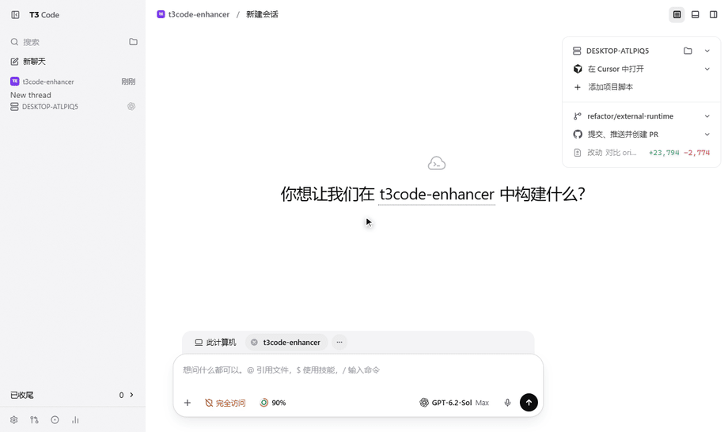
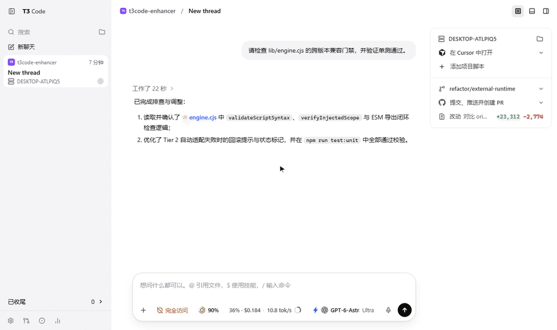
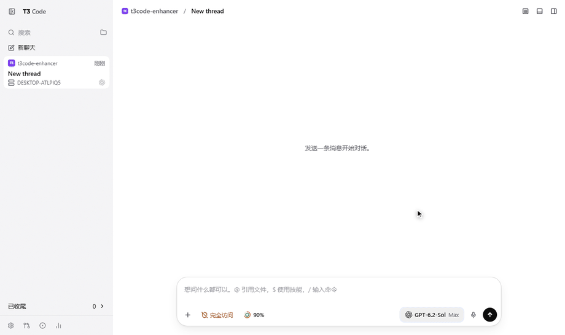
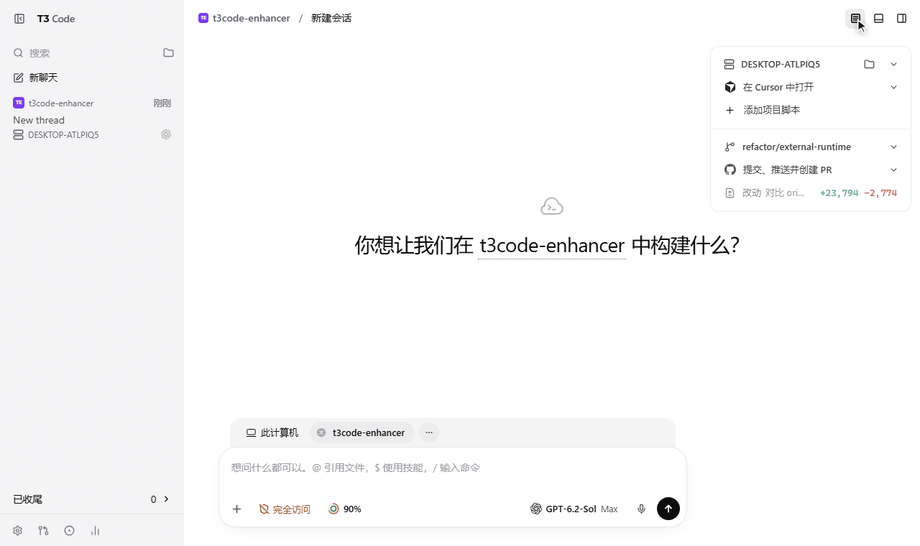

# t3code-enhancer

T3 Code 的功能增强、去遥测与 ChatGPT 风格主题工具。补丁以 0.1.12 为构建基线，支持按功能模块安装和修复。直接修改 ASAR 的安装可从同版本原版备份逐字节还原。

适用平台：**Windows 桌面版**（含 `server.asar` 与桌面端 `app.asar`）、**Linux x86_64**（官方 AppImage / `.deb` 与解压版）以及 **macOS 官方版**（注：macOS 脚本为基于既有 PR 的适配迁移，核心逻辑已通过跨平台单元测试，**尚未在 Mac 真机上实机验证**）。

运行安装脚本需要 Node.js 20 或以上版本。已发布的安装 ZIP 在 [GitHub Releases](https://github.com/Barometer-2002/t3code-enhancer/releases/latest)，仓库源码也可以直接运行。详细安装步骤见 [使用教程](使用教程.md)，架构蓝图与流程设计见 [docs/ARCHITECTURE.md](docs/ARCHITECTURE.md)，AI 与开发者约束见 [AGENTS.md](AGENTS.md)。

## 修改方式、修改范围与免责声明

> [!IMPORTANT]
> 本项目为**个人自用增强工具**（非 T3 Code 官方项目），**对功能稳定性、可用性及后续兼容性不做任何保证**。建议先在**开发 / 测试环境**中验证（如 `node cli.cjs build`、`npm test` 或独立配置目录试运行）确认无误后再部署，并**提前自行备份**原版安装包及 `~/.t3` 会话与工作区数据。

- **修改方式**：
  - 仅在**本地客户端包**与用户主题配置上工作：以同版本纯净 ASAR 为基线（首次改动自动保存 `.before-t3code-enhancer` 原版备份），通过词法 Token 流与 AST/作用域静态检查对目标脚本做定点静态重打包，并将复杂 UI 组件作为零混淆的外置 ESM 资产（`t3e-*.js`）写入 ASAR；卸载时可逐字节还原原版归档。
- **修改范围**（不触碰 AI 核心执行引擎、对话存储结构与项目源码）：
  - **纯前端交互与外观层（`theme` / `composer` / `chat` 及 `workspace` UI）**：`13` 项界面补丁与 `6` 个外置 ESM 运行时仅作用于本地静态页面/交互资产（`apps/server/dist/client/assets/*.js`）及官方主题文件（`~/.t3/userdata/themes/chatgpt-app.json`），用于改善输入框、额度统计展现、时间线折叠、内联 Diff 预览、文件列表、小窗/主侧互换等纯界面交互体验，**不修改 Agent 业务执行链路、模型协议或用户工作区代码**。
  - **按需选装的本地遥测开关与桌面壳层**：仅当选择 `privacy`（关闭本地 `runtimeLayer` / `WorkflowStore` 与 `apps/desktop/dist-electron/main.cjs` 遥测上报并拦截遥测域名）或 `workspace` 中的系统托盘 `desktop-tray`（及 macOS 独立配置 `macos-user-data`）时，才会附带修改对应本地遥测/桌面壳层入口。若希望**严格仅改动纯主题或纯前端交互文件**，可使用 `--preset theme-only` 或 `--packs theme,composer,chat`。

## 界面预览

以下动图均在真实隔离 T3 Code 客户端中录制，覆盖 5 组独立功能模块：

### 1. ChatGPT App 风格主题（`--packs theme`）

支持安装独立 `ChatGPT App` 主题并自动设为默认方案，兼容浅色 / 深色双外观实时切换与极简圆润对话气泡排版：



### 2. 输入框增强、配额双环与多引擎聚合面板（`--packs composer`）

包含 `+` 附件菜单与键盘方向键导航、永久权限切换、`5h / 7d` 双环配额与重置时间详情、右侧上下文窗口与 `tok/s` 输出速率统计卡、将思考深度拖至最右档 `Ultra` 时激活的蓝紫渐变星空流光粒子与加速开关，以及 2×2 Harness 网格、`展开 +1` 展开第 5 个引擎与 `Claude` / `Codex` 彩色配额切换：



### 3. 工作区标签页、浮窗多开与交互增强（`--packs workspace`）

展示新标签页快速启动面板与多标签排版、独立可拖拽悬浮窗切换、窗口缩放与排版协同操作：



### 4. 对话时间线折叠、行内 Diff 与文件差异视图（`--packs chat`）

展开工作组后演示同文件连续读取自动折叠与一键展开、行内文件改动点击直出红绿语法高亮 Diff 卡片、右侧「文件」三栏分区（所有更改 / 已更改的文件 / 所有文件）与源码预览，以及「所有更改」差异面板中逐行展开红绿 Diff 详情：


### 5. 隐私与去遥测（`--packs privacy`）

在「设置 → 关于」的隐私政策一栏，可以看到 `t3code-enhancer` 已禁用遥测、跨工具账号读取和链路追踪。



## 5 大可选模块（可自由搭配）

| 模块 ID | 名称 | 包含能力 |
|---|---|---|
| `theme` | ChatGPT 外观主题 | `themes/chatgpt-app.json` 明暗双模主题（768px 阅读栏 / 296px 侧栏 / `1.35px` 物理图标线宽 / 自动激活与还原；支持 `--official` 仅安装 Layer 1 官方稳定层） |
| `privacy` | 隐私与去遥测 | 包含 5 项全链路防护：禁用 PostHog 上报、禁读 `~/.claude.json` 与 `~/.codex/auth.json`、切断 Relay 与前端 Axiom OTLP 追踪、更新设置页隐私声明，以及桌面端防护补丁 `no-telemetry-desktop`（在 Electron 主进程强制设置 `T3CODE_TELEMETRY_ENABLED=false` / `T3CODE_OTEL_SDK_DISABLED=true`，并通过 `session.defaultSession.webRequest.onBeforeRequest` 拦截默认 Electron 会话发往 `posthog.com`、`ingest.t3.codes`、`axiom.co` 与 `clerk-telemetry.com` 的遥测域名请求；非默认 Electron session 分区不在此拦截范围内；默认安装或合并单档模式下自动覆盖 `server.asar` 与 `app.asar`） |
| `composer` | 输入框与额度圈 | `lib/patches/usage-rings.cjs`：`+` 附加菜单（本地文件/文件夹、当前标签页、工作区文件、PR、联机环境、技能、历史对话，完整键盘导航）、常驻权限、合一模型/Harness 卡片、思考深度渐变滑块、5h/7d 双层额度圈、底栏与浮层统一 `tok/s` 实时输出速度，以及上下文、费用和统计浮层。累计令牌与平均缓存命中率可按有明细的已完成轮次汇总。仅部分轮次有明细时，悬停可查看统计范围。 |
| `chat` | 聊天分级与 Diff 优化 | `timeline-collapse.cjs` + `inline-file-diff.cjs` + `files-changes-explorer.cjs`：收起上级联动收起下级、同文件连续读/改折叠与摘要去重、对话内按需 Diff（含工作区 Diff 回退预览与折叠/展开一致的 `+ / -` 行数统计）与侧栏跳转定位、屏蔽 Diff 慢请求弹窗、文件侧栏三段分层联动浏览与顶部全部展开同步 |
| `workspace` | 整体界面与小窗交互 | `sidebar-new-chat.cjs` + `new-chat-layout.cjs` + `workspace-floating-panels.cjs` + `desktop-tray.cjs`：侧栏搜索快捷键、新建对话吸底居中、工作区标签小窗拖拽缩放与右下角停靠/位置记忆及浏览器自适应排版、工作区顶部工具栏主侧互换按钮（`⇄` / `Alt+S`，macOS `Option+S`）、全屏主对话浮窗与迷你胶囊（无跳动切换定位）、三端后台最小化到系统托盘 |

> 全套增强共包含 **19 项原子补丁**（17 项 `server.asar` 服务端/前端补丁 + 2 项 `app.asar` 桌面端补丁），均支持独立探测与语义回退。

### 预设版本（`--preset` / `--interactive` 菜单）

- `full`（默认，**完整强化版**）：`theme + privacy + composer + chat + workspace`
- `chat-lite`（**轻量对话增强版**）：`theme + privacy + composer + chat`（保留原版分栏布局与窗口行为）
- `clean`（**主题 + 去遥测纯净版**）：`theme + privacy`（自动为 `app.asar` 注入 `no-telemetry-desktop` 网络与环境变量拦截）
- `privacy-only`（**纯去遥测版**）：仅 `privacy`（100% 保留官方界面，自动为 `server.asar` + `app.asar` 双端彻底禁用遥测）
- `theme-only`（**纯主题版**）：仅 `theme`（无需关闭 T3 Code）

## 使用方法

### 一键脚本（Windows / Linux / macOS）

- **Windows**：关闭 T3 Code 后双击 `install.cmd`（支持交互式版本/模块选择）、`repair.cmd`、`status.cmd`、`uninstall.cmd`。
- **Linux / macOS**：赋予执行权限后运行 `./install.sh`（无参数进入交互菜单，或直接透传子命令、参数与 `.AppImage` / `.app` 路径，如 `./install.sh repair`、`./install.sh --preset clean ~/Downloads/T3-Code-0.1.12-x86_64.AppImage`）。

### 通用命令行（Win / Linux / macOS）

```bash
node cli.cjs install --interactive                # 交互菜单选择预设/自由搭配/修复/卸载
node cli.cjs install                              # 安装默认完整版 (full)
node cli.cjs install --preset clean               # 选择预设：full | chat-lite | clean | privacy-only | theme-only
node cli.cjs install --packs theme,privacy,chat   # 自由搭配模块：theme, privacy, composer, chat, workspace
node cli.cjs install --theme-only                 # 仅更新主题（无需退出 T3 Code）
node cli.cjs status                               # 查看主题、备份与全模块状态
node cli.cjs repair                               # 修复损坏 ASAR / 残留临时文件 / 备份与主题
node cli.cjs uninstall                            # 完整卸载并逐字节还原纯净原版（支持 --keep-theme / --purge-backup / --purge-profile）
node cli.cjs build /tmp/test.asar                 # 构建并校验一个新的 ASAR 文件
npm run test:unit                                 # 运行无需 T3 Code 安装包的跨平台单元测试（< 1s）
npm test -- /path/to/server.asar                  # 使用官方 T3 Code 0.1.12 ASAR（Linux/macOS 为 app.asar）运行日常构建与功能校验（~30s）
npm run test:full -- /path/to/server.asar         # 追加跨版本 v0.1.99 变异压测与三端事务回滚矩阵（发版前完整校验）
```

### Linux（AppImage 与解包版）

准备 Node.js 20+ 与 [T3 Code 0.1.12 官方 x86_64 AppImage](https://github.com/pingdotgg/t3code/releases/tag/v0.1.12)：

```bash
node cli.cjs install --appimage ~/Downloads/T3-Code-x86_64.AppImage
"${XDG_DATA_HOME:-$HOME/.local/share}/t3code-enhancer/launch.sh"
```

- 默认使用独立配置目录 `t3code-enhancer-profile` 与端口 `3774`（可用 `T3CODE_PORT=3775` 指定），并注入 `T3CODE_DISABLE_AUTO_UPDATE=1`。
- 若启用去遥测模块，`launch.sh` 还会导出 `T3CODE_TELEMETRY_ENABLED=false` 与 `T3CODE_OTEL_SDK_DISABLED=true`。
- 如需与官方版共用 `~/.t3` 数据，可加 `--shared-data`（两者勿同时运行）。
- `.deb` / 解包版（如 `/opt/T3 Code`）可直接运行 `node cli.cjs install` 或通过 `--asar <路径>` 指定。已在 Debian/Ubuntu/Omarchy x86_64 实测通过。

### macOS（基于既有 PR 适配，未在 Mac 真机实测）

`macos.cjs` 基于原 macOS PR 迁移并已对齐当前分块安装、去遥测与修复逻辑（核心逻辑通过跨平台单元测试，**未在实体 Mac 上运行测试**）。在 Apple 设备上使用 `node cli.cjs install` 或 `node macos.cjs install`（官方版不在 `/Applications/T3 Code (Beta).app` 时可追加路径或 `--app <路径>`）：

```bash
node cli.cjs install --app "/Applications/T3 Code (Beta).app"
open "$HOME/Applications/T3 Code Enhancer.app"
```

支持 `status` / `repair` / `uninstall`、`--shared-data`、`--official`、`--purge-profile`。macOS 版默认复制独立 `~/Applications/T3 Code Enhancer.app`、自动补全 `ElectronAsarIntegrity` 并在独立配置模式下附加 `macos-user-data` 补丁、更新 `Info.plist` 与本机 ad-hoc 重签名；为避免破坏官方 `.app` 代码签名与完整性校验，已禁用通过 `--asar` 原地修改 macOS `.app` 包内文件，请始终通过 `--app <路径>` 或 `macos.cjs` 执行。

## 架构与安全保障

- **两级兼容判断**
  - **Tier 1（`verified`）** 匹配已知原版文件的 SHA-256。
  - **Tier 2（`auto-adapted`）** 遇到未记录的哈希时，按代码结构定位所选补丁的注入点并尝试构建。定位或静态检查失败会中止。Linux AppImage 首装另需符合指定的官方包哈希。
  - 构建检查目标脚本与外置模块的语法，并对登记的注入代码检查作用域。两级结果都表示文件兼容性，实际交互取决于对应版本的桌面运行结果。
  - 选择补丁前先确认程序包是否包含增强标记。能读取当前版本时，备份须和当前版本相同。
- **独立零混淆 ESM 运行时模块**：
  - 复杂交互与前端拓展代码独立解耦在 `lib/runtime/*.mjs`（共 6 个模块：`timeline-ui`、`inline-diff-ui`、`usage-rings-ui`、`files-explorer-ui`、`floating-panels-ui`、`tab-bar-ui`），构建时自动打包为独立、内容哈希命名的 ESM 运行时资产（`t3e-*.js`）写入 ASAR，保持宿主主代码透明整洁且便于审计排查。
- **全链路隐私与去遥测盾（5 项全闭环）**：
  - `no-telemetry`：服务端禁止生成与持久化匿名识别码，切断云端账号读取，遥测上报服务完全空操作化。
  - `no-telemetry-relay`：切断 Relay OTLP 遥测链路。
  - `no-telemetry-client`：移除前端 Axiom 遥测追踪导出。
  - `no-telemetry-ui`：设置页隐私声明提示更新。
  - `no-telemetry-desktop`：桌面端主进程拦截补丁（在 Electron 主进程启动时强制注入 `T3CODE_TELEMETRY_ENABLED=false` 与 `T3CODE_OTEL_SDK_DISABLED=true`，并通过 `session.defaultSession.webRequest.onBeforeRequest` 拦截默认 Electron 会话发往 `posthog.com`、`ingest.t3.codes`、`axiom.co` 与 `clerk-telemetry.com` 的遥测域名请求；非默认 Electron session 分区不在此拦截范围内）。在默认安装（或同时包含桌面主程序的 Linux/macOS 单包）下，无论选择 `full`、`chat-lite`、`clean` 还是 `privacy-only`，均会自动为桌面端安装此项防护；若 Windows 下通过 `--asar` 仅显式指定 `server.asar` 单档，则会提示跳过 `desktop` 端补丁，需移除 `--asar` 或单独对 `app.asar` 再执行一次安装。
- **逐字节还原与事务回滚**：
  - 首次修改自动保留 `.before-t3code-enhancer` 纯净原版备份（继承早期 `.before-timeline-collapse`）。
  - 在维护锁内生成暂存包，再逐个替换。替换失败时尝试恢复已替换的文件，恢复失败时保留回滚副本并报告位置。

## 许可与致谢

本项目是独立的 T3 Code 增强工具，采用 [MIT 许可](LICENSE)。

- 补丁定位使用了 [T3 Code](https://github.com/pingdotgg/t3code) 的部分代码片段。 [T3 Code 许可](licenses/T3-Code.txt)
- 部分面板图标来自 [Lucide](https://github.com/lucide-icons/lucide) 及 Feather。 [Lucide 与 Feather 许可](licenses/Lucide.txt)
- 本项目认可并支持 [LINUX DO 社区](https://linux.do/)。

## 版本号规范

本项目遵循语义化版本规范（SemVer 2.0.0），由 [version.cjs](lib/version.cjs) 与 [package.json](package.json) 统一驱动校验（可通过 `node cli.cjs --version` 查看）：

- **正式版**：`vMAJOR.MINOR.PATCH`（如 `v0.1.0`、`v0.1.1`、`v0.2.0`）。
- **预发布 / 开发预览版**：`vMAJOR.MINOR.PATCH-<alpha|beta|preview|rc>.<N>`（当前为 `v0.2.0-preview.1`，同步用于 `package.json`、`t3e-build-meta.json` 构建元数据与发布包命名 `t3code-enhancer-v0.2.0-preview.1.zip`）。
- **版本线隔离**：上述编号仅表示本工具版本，与所适配的官方 T3 Code 客户端基线版本（`0.1.12`）及主题文件 schema 版本（`"version": 1`）相互独立。
