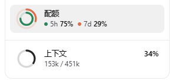
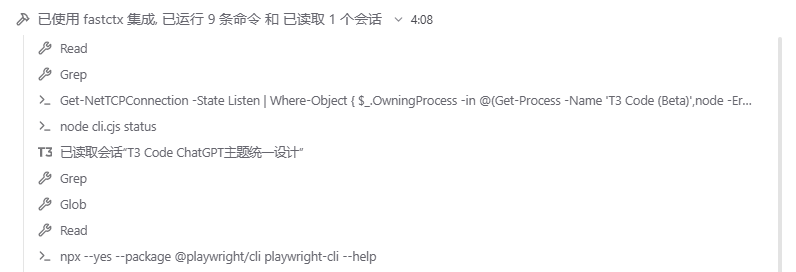

# t3code-enhancer

T3 Code 0.1.11 的全功能体验增强、去遥测与 ChatGPT 风格主题工具，支持分块自由搭配安装、原地修复与逐字节还原卸载。

适用平台：**Windows 桌面版**（含 `server.asar` 与系统托盘 `app.asar`）、**Linux x86_64**（官方 AppImage / `.deb` 与解压版）以及 **macOS 官方版**（注：macOS 脚本为基于既有 PR 的适配迁移，核心逻辑已通过跨平台单元测试，**尚未在 Mac 真机上实机验证**）。

从 [GitHub Releases](https://github.com/Barometer-2002/t3code-enhancer/releases/latest) 下载安装 ZIP，详细说明与常见问题见 [使用教程](使用教程.md)。

## 界面预览


| 加号菜单 | 模型与 Harness |
| :---: | :---: |
|  |  |

| 思考深度 | 右侧详情面板 |
| :---: | :---: |
|  |  |

| 额度详情 | 上下文与统计 |
| :---: | :---: |
|  |  |



## 5 大可选模块（可自由搭配）

| 模块 ID | 名称 | 包含能力 |
|---|---|---|
| `theme` | ChatGPT 外观主题 | `themes/chatgpt-app.json` 明暗双模主题（768px 阅读栏 / 296px 侧栏 / `1.35px` 物理图标线宽 / 自动激活与还原；支持 `--official` 仅安装 Layer 1 官方稳定层） |
| `privacy` | 隐私与去遥测 | `lib/patches/no-telemetry.cjs`：禁用 PostHog 上报、禁读 `~/.claude.json` 与 `~/.codex/auth.json`、切断 Relay 与前端 Axiom OTLP 追踪、更新设置页隐私声明并默认禁用遥测环境变量 |
| `composer` | 输出框与额度圈 | `lib/patches/usage-rings.cjs`：`+` 附加菜单（本地文件/文件夹、当前标签页、工作区文件、PR、联机环境、技能、历史对话，完整键盘导航）、常驻权限、合一模型/Harness 卡片、思考深度渐变滑块、5h/7d 双层额度圈与上下文/费用/统计浮层 |
| `chat` | 聊天分级与 Diff 优化 | `timeline-collapse.cjs` + `inline-file-diff.cjs` + `files-changes-explorer.cjs`：收起上级联动收起下级、同文件连续读/改折叠与摘要去重、对话内按需 Diff 与侧栏跳转定位、屏蔽 Diff 慢请求弹窗、文件侧栏三段分层联动浏览 |
| `workspace` | 整体界面与小窗交互 | `sidebar-new-chat.cjs` + `new-chat-layout.cjs` + `workspace-floating-panels.cjs` + `desktop-tray.cjs`：侧栏搜索快捷键、新建对话吸底居中、工作区标签小窗拖拽缩放与浏览器自适应排版、左右主侧互换（`⇄` / `Alt+S`）、全屏主对话浮窗与迷你胶囊（无跳动切换定位）、后台最小化到系统托盘 |

### 预设版本（`--preset` / `--interactive` 菜单）

- `full`（默认，**完整强化版**）：`theme + privacy + composer + chat + workspace`
- `chat-lite`（**轻量对话增强版**）：`theme + privacy + composer + chat`（保留原版分栏布局与窗口行为）
- `clean`（**主题 + 去遥测纯净版**）：`theme + privacy`
- `privacy-only`（**纯去遥测版**）：仅 `privacy`（100% 保留官方界面）
- `theme-only`（**纯主题版**）：仅 `theme`（无需关闭 T3 Code）

## 使用方法

### 一键脚本（Windows / Linux / macOS）

- **Windows**：关闭 T3 Code 后双击 `install.cmd`（支持交互式版本/模块选择）、`repair.cmd`、`status.cmd`、`uninstall.cmd`。
- **Linux / macOS**：赋予执行权限后运行 `./install.sh`（无参数进入交互菜单，或直接透传子命令与参数，如 `./install.sh repair`、`./install.sh uninstall`）。

### 通用命令行（Win / Linux / macOS）

```bash
node cli.cjs install --interactive                # 交互菜单选择预设/自由搭配/修复/卸载
node cli.cjs install                              # 安装默认完整版 (full)
node cli.cjs install --preset clean               # 选择预设：full | chat-lite | clean | privacy-only | theme-only
node cli.cjs install --packs theme,privacy,chat   # 自由搭配模块：theme, privacy, composer, chat, workspace
node cli.cjs install --theme-only                 # 仅更新主题（无需退出 T3 Code）
node cli.cjs status                               # 查看主题、备份与全模块状态
node cli.cjs repair                               # 修复损坏 ASAR / 残留临时文件 / 备份与主题
node cli.cjs uninstall                            # 完整卸载并逐字节还原纯净原版（支持 --keep-theme / --purge-backup / --purge-profile）
node cli.cjs build /tmp/test.asar                 # 在副本上试构建并校验（不改动已安装的 T3 Code）
node tests/verify.cjs                             # 运行全部自动化单元测试与干跑构建校验
```

### Linux（AppImage 与解包版）

准备 Node.js 20+ 与 [T3 Code 0.1.11 官方 x86_64 AppImage](https://github.com/pingdotgg/t3code/releases/tag/v0.1.11)：

```bash
node cli.cjs install --appimage ~/Downloads/T3-Code-x86_64.AppImage
"${XDG_DATA_HOME:-$HOME/.local/share}/t3code-enhancer/launch.sh"
```

- 默认使用独立配置目录 `t3code-enhancer-profile` 与端口 `3774`（可用 `T3CODE_PORT=3775` 指定），并注入 `T3CODE_DISABLE_AUTO_UPDATE=1`。
- 若启用去遥测模块，`launch.sh` 还会导出 `T3CODE_TELEMETRY_ENABLED=false` 与 `T3CODE_OTEL_SDK_DISABLED=true`。
- 如需与官方版共用 `~/.t3` 数据，可加 `--shared-data`（两者勿同时运行）。
- `.deb` / 解包版（如 `/opt/T3 Code`）可直接运行 `node cli.cjs install` 或通过 `--asar <路径>` 指定。已在 Debian/Ubuntu/Omarchy x86_64 实测通过。

### macOS（基于既有 PR 适配，未在 Mac 真机实测）

`macos.cjs` 基于原 macOS PR 迁移并已对齐当前分块安装、去遥测与修复逻辑（核心逻辑通过跨平台单元测试，**未在实体 Mac 上运行测试**）。在 Apple 设备上使用 `node cli.cjs install` 或 `node macos.cjs install`（官方版不在 `/Applications/T3 Code (Beta).app` 时可追加路径或 `--app <路径>`）：

```bash
node cli.cjs install --app "/Applications/T3 Code (Beta).app"
open "$HOME/Applications/T3 Code Enhancer.app"
```

支持 `status` / `repair` / `uninstall`、`--shared-data`、`--official`、`--purge-profile`，若需仅更新特定解压版 ASAR 也可回退使用 `node cli.cjs install --asar <path>`。

## 安全保障
- 安装前校验原版片段哈希，首次修改自动保存 `.before-t3code-enhancer` 纯净备份（兼容继承早期 `.before-timeline-collapse` 备份）；检测到非 `0.1.11` 未知版本时立即中止，绝不用旧备份覆盖新版本。
- 写入前自动完成脚本语法检查、ASAR 头部 SHA-256 块校验与全量未修改字节比对。

## 许可与致谢

本项目是独立的 T3 Code 增强工具，采用 [MIT 许可](LICENSE)。

- 补丁定位使用了 [T3 Code](https://github.com/pingdotgg/t3code) 的部分代码片段。 [T3 Code 许可](licenses/T3-Code.txt)
- 部分面板图标来自 [Lucide](https://github.com/lucide-icons/lucide) 及 Feather。 [Lucide 与 Feather 许可](licenses/Lucide.txt)
- 本项目认可并支持 [LINUX DO 社区](https://linux.do/)。
