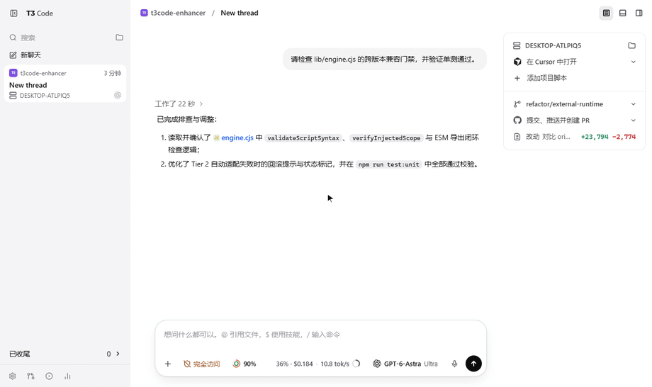

<div align="center">


# t3code-enhancer

**让 T3 Code 更接近 ChatGPT 桌面版**<br/>
更顺眼的整体界面 · 更干净的隐私去遥测 · 后台系统托盘 · 更顺手的对话与多浮窗工作区

<p align="center"><a href="https://github.com/Barometer-2002/t3code-enhancer/releases/tag/v0.2.0-preview.1"></a> <a href="https://github.com/pingdotgg/t3code/releases/tag/v0.1.12"></a> <a href="https://nodejs.org/"></a> <a href="#核心体验"></a> <a href="#平台支持"></a> <a href="#说明与许可"></a></p>

**[⬇ 下载 v0.2.0-preview.1 预览版](https://github.com/Barometer-2002/t3code-enhancer/releases/tag/v0.2.0-preview.1)** · [实机演示](#实机演示) · [核心体验](#核心体验) · [快速开始](#快速开始) · [按需搭配](#按需搭配) · [文档导航](#文档导航)

<sub>纯本地运行 · 零外部依赖 · 自动保留原版备份，随时一键还原</sub>

</div>

## 实机演示

以下动图均在真实 T3 Code `0.1.12` 客户端中录制（点击图片可放大查看）：

<table>
  <tr>
    <td width="50%" valign="top">
      <strong>整体界面重塑与双模主题</strong><br/>
      <sub>明暗双模 ChatGPT App 风格、<code>1.35px</code> 图标线宽与侧栏/新建页重构 · <a href="docs/FEATURES.md#1-整体界面重塑与双模主题">详情</a></sub><br/><br/>
      
    </td>
    <td width="50%" valign="top">
      <strong>输入框、模型面板与双环额度</strong><br/>
      <sub><code>+</code> 附件菜单、思考深度滑块、<code>5h/7d</code> 双环与实时 <code>tok/s</code> · <a href="docs/FEATURES.md#4-输入框模型面板与实时统计">详情</a></sub><br/><br/>
      
    </td>
  </tr>
  <tr>
    <td width="50%" valign="top">
      <strong>工作区启动台、多浮窗与左右互换</strong><br/>
      <sub>空白页单键启动、标签拖出浮窗、<code>Alt+S</code> 左右互换 · <a href="docs/FEATURES.md#6-工作区启动台多浮窗与左右互换">详情</a></sub><br/><br/>
      
    </td>
    <td width="50%" valign="top">
      <strong>对话时间线、行内 Diff 与文件栏</strong><br/>
      <sub>同文件折叠去重、红绿行内 Diff、三段变更文件视图 · <a href="docs/FEATURES.md#5-对话时间线行内-diff-与文件栏">详情</a></sub><br/><br/>
      
    </td>
  </tr>
</table>

## 核心体验

每一项增强均可按模块自由开关，不修改对话记录、项目代码与 AI 核心逻辑：

| 体验模块 | 带来什么变化 | 详情 |
| --- | --- | --- |
| **ChatGPT App 双模主题与布局** | 明暗双模主题自动激活、浅灰侧栏与卡片化主画布、侧栏常驻搜索与独立「新聊天」、顺手的新建对话吸底布局 | [详情](docs/FEATURES.md#1-整体界面重塑与双模主题) |
| **全局视觉效果优化** | 全界面图标物理线宽统一 `1.35px`、正文/代码/时间线排版与间距对齐、圆角表单与胶囊工具栏、文件预览/浏览器/终端与状态卡质感统一 | [详情](docs/FEATURES.md#全局视觉效果优化) |
| **右下角后台系统托盘** | 点 `×` 隐藏到托盘不中断长任务，单击立刻唤回，右键随时切换「直接退出」或彻底关闭 | [详情](docs/FEATURES.md#2-右下角后台系统托盘) |
| **全链路隐私与去遥测** | 关闭匿名上报、停止读取本机 Claude / Codex 账号文件，并在桌面端拦截遥测域名 | [说明](docs/PRIVACY_AND_SECURITY.md) |
| **输入框、模型与实时统计** | 圆形 `+` 菜单快速附加 7 类上下文、常驻权限、思考深度滑块（最高档星空流光）、`5h/7d` 双环额度与底栏实时 `tok/s` | [详情](docs/FEATURES.md#4-输入框模型面板与实时统计) |
| **对话时间线与行内 Diff** | 同文件连续读写自动折叠去重，对话内点击直出红绿语法高亮 Diff，文件栏升级为三段变更视图 | [详情](docs/FEATURES.md#5-对话时间线行内-diff-与文件栏) |
| **工作区启动台与多浮窗** | 新标签页搜索栏与单键启动、标签拖出变可缩放浮窗、全屏主对话状态胶囊、`Alt+S` 一键左右互换 | [详情](docs/FEATURES.md#6-工作区启动台多浮窗与左右互换) |

## 快速开始

准备 **Node.js 20+**，下载 **[v0.2.0-preview.1 预览版压缩包](https://github.com/Barometer-2002/t3code-enhancer/releases/tag/v0.2.0-preview.1)** 并解压（无需 `npm install`；右侧 Releases 栏默认展示的是旧版 `v0.1.1`，本页全部新功能请从预览版下载，历史版本见 [全部 Releases](https://github.com/Barometer-2002/t3code-enhancer/releases)）：

**Windows**
1. 退出 T3 Code（若在托盘运行，右键右下角图标点击退出）。
2. 双击 **`install.cmd`**，直接回车安装默认完整版（或按菜单编号自由选择）。
3. 重新启动 T3 Code；随时可双击 **`uninstall.cmd`** 一键还原原版。

**Linux / macOS**
```bash
chmod +x install.sh
./install.sh
```

> Linux AppImage 与 macOS 独立副本的完整步骤见 **[安装与使用教程](使用教程.md)**。

## 按需搭配

不想全装？可以在交互菜单里挑选，或通过 `--preset` 一步指定：

| 预设 | 适合谁 | 包含内容 |
| --- | --- | --- |
| `full`（默认） | 想要完整体验 | 主题 + 去遥测 + 输入框/额度 + 时间线/Diff + 布局/浮窗/托盘 |
| `chat-lite` | 喜欢官方原本布局 | 主题 + 去遥测 + 输入框/额度 + 时间线/Diff |
| `clean` | 只要颜值和隐私 | 主题 + 去遥测（零交互改动） |
| `privacy-only` | 只要去遥测 | 100% 保留官方界面，仅关闭遥测 |
| `theme-only` | 只想换个皮肤 | 仅安装外观主题，无需重启 T3 Code |

```bash
node cli.cjs install --preset clean                   # 只要主题 + 去遥测
node cli.cjs install --preset full --no-desktop-tray  # 完整版，但不要托盘最小化
node cli.cjs uninstall                                # 一键还原官方原版
```

## 平台支持

- **Windows（官方桌面版）** — ✅ 已实测，安装前自动保留原版备份。
- **Linux x86_64（AppImage / `.deb` / 解包版）** — ✅ 已实测，AppImage 默认独立目录运行、互不干扰。
- **macOS\*（官方 `.app`）** — 🧪 已通过跨平台单元测试，**诚征 Mac 真机试用反馈**（默认生成独立副本，不动官方原版）。

## 文档导航

按需渐进阅读，从 3 分钟上手到安全审计各取所需：

- **[安装与使用教程](使用教程.md)** — 分平台安装步骤、日常升级、修复与一键还原
- **[功能详解](docs/FEATURES.md)** — 整体界面重塑、后台系统托盘、全部功能亮点与快捷键速查
- **[隐私与安全说明](docs/PRIVACY_AND_SECURITY.md)** — 修改范围边界、5 层去遥测明细、明文代码审计与备份机制
- **[CLI 命令参考](docs/CLI_REFERENCE.md)** — 全部子命令、选项参数、自由搭配与测试命令速查
- **[常见问题与排查](docs/TROUBLESHOOTING.md)** — 按现象直给解法（托盘、统计口径、升级兼容、反馈模板）
- **[架构蓝图](docs/ARCHITECTURE.md)** · **[开发者指南](AGENTS.md)** — 内部架构、补丁映射与维护约定

## 说明与许可

本项目是个人维护的独立开源工具（与 T3 Code 官方无关），采用 [MIT 许可](LICENSE)。工具默认保留同版本原版备份并提供回滚保护，日常重要工作前仍建议顺手备份 `~/.t3`；如只想先尝鲜，也可以先选 `theme-only` 或用 `node cli.cjs build` 试构建。

- 部分界面定位参考了 [T3 Code](https://github.com/pingdotgg/t3code)（[许可](licenses/T3-Code.txt)）。
- 部分面板图标来自 [Lucide](https://github.com/lucide-icons/lucide) 与 Feather（[许可](licenses/Lucide.txt)）。
- 认可并支持 [LINUX DO 社区](https://linux.do/)。

## 版本号规范

本项目遵循语义化版本（SemVer 2.0.0），由 [lib/version.cjs](lib/version.cjs) 与 [package.json](package.json) 统一管理（执行 `node cli.cjs --version` 查看）：

- **正式版**：`vMAJOR.MINOR.PATCH`（如 `v0.1.0`、`v0.1.1`、`v0.2.0`）
- **预览版**：`vMAJOR.MINOR.PATCH-<alpha|beta|preview|rc>.<N>`（当前为 `v0.2.0-preview.1`）
- 工具版本号与所适配的官方 T3 Code 基线版本（`0.1.12`）相互独立
