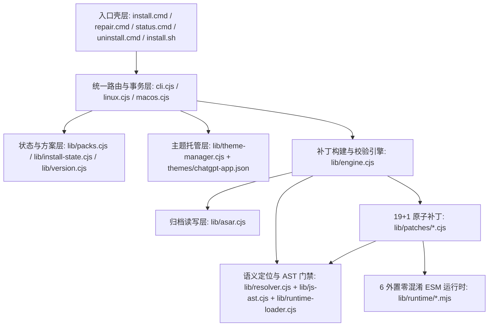
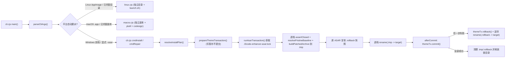
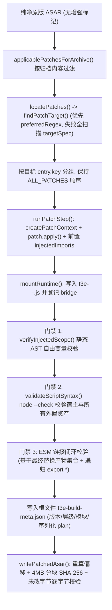
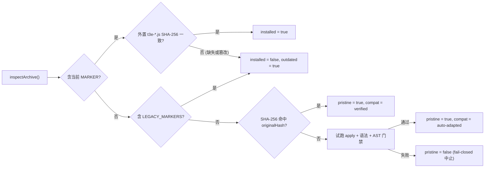

# t3code-enhancer 架构蓝图与核心流程设计

> [项目首页](../README.md) · [安装与使用教程](../使用教程.md) · [功能详解](FEATURES.md) · [隐私与安全](PRIVACY_AND_SECURITY.md) · [CLI 速查](CLI_REFERENCE.md) · [故障排查](TROUBLESHOOTING.md) · **架构蓝图** · [开发者约束](../AGENTS.md)
>
> 本文档面向 **AI Agent** 与 **接手开发者**，将整个仓库压缩为可直接导航、理解与安全修改的架构蓝图。硬性开发红线与真实踩坑清单见根目录 [AGENTS.md](../AGENTS.md)。

---

## 1. 系统分层与依赖拓扑（Repo Map）

全项目采用 **零外部依赖** 纯 Node.js（`>= 20`）CommonJS 架构，唯独外置前端运行时采用零 `import` 的 ESM（`lib/runtime/*.mjs`）。依赖关系严格单向向下，无循环依赖：

### 核心文件职责速查

| 文件 | 职责与核心导出 |
| --- | --- |
| `cli.cjs` | 统一跨平台入口：`parseCliArgs`、Linux/macOS 自动委派（`shouldDelegateToLinux`/`shouldDelegateToMacos`）、Windows 双档事务（`runAsarTransaction`）、`cmdInstall`/`cmdRepair`/`cmdUninstall`/`cmdStatus`/`cmdBuild` |
| `linux.cjs` | Linux AppImage 首次校验解压（`APPIMAGE_HASH`）、独立/共享配置目录、`launch.sh` 生成、原地升级与回滚 |
| `macos.cjs` | macOS 独立 `.app` 副本复制、`macos-user-data` 附加补丁、`Info.plist`/`ElectronAsarIntegrity` 更新、ad-hoc 重签名 |
| `lib/engine.cjs` | 补丁总注册表（`ALL_PATCHES`、`PATCH_RUNTIME_NAMES`）、归档探测（`inspectArchive`）、基线核对（`resolvePristineBaseline`）、核心构建与门禁（`buildPatchedArchive`）、无参修复方案反推（`inferRepairPlanOptions`） |
| `lib/resolver.cjs` | 跨版本 chunk 语义发现（`findEntryBySpec`/`findPatchTarget`）、补丁上下文（`createPatchContext`：`resolveImportedAlias`/`ensureChunkImport`/`resolveReactBindings`/`addRuntimeAsset`/`allocateMemoSlots`）、静态作用域门禁（`verifyInjectedScope`） |
| `lib/js-ast.cjs` | 零依赖 ES2022 词法/结构分析器：`tokenize`、`parseImports`/`parseExports`、`findUniqueFunction`/`findEnclosingFunction`、`findStatementEndWithTokens`/`findMatchingChar`、`allocateMemoSlots`、`findUndeclaredIdentifiers` |
| `lib/runtime-loader.cjs` | 外置运行时加载器：`mountRuntime`（真实 ASAR 写哈希资产 + 顶部 `import`；单测自动内联）、`loadRuntimeExports`（Node VM 直接复用纯函数） |
| `lib/asar.cjs` | ASAR 二进制解包/重打包与完整性维护：`readAsar`、`readVerifiedEntry`、`writePatchedAsar`（重算偏移与 4MB 分块 SHA-256）、`validateScriptSyntax`（`node --check`）、`writeVerifiedAsarCopy` |
| `lib/packs.cjs` | 5 大模块（`PACKS`）、5 档预设（`PRESETS`）、联动禁用组（`PATCH_GROUPS`）、安装方案解析（`resolveInstallPlan`）与交互菜单 |
| `lib/install-state.cjs` | 目录级维护锁（`withInstallDirectoryLock`）、原子目录替换与回滚（`replaceStagedInstall`、`recoverPreviousInstall`） |
| `lib/theme-manager.cjs` | 主题 3 层裁剪（`extractOfficialTheme`）、SHA-256 托管所有权识别（`KNOWN_HISTORICAL_THEME_HASHES` + `.t3code-enhancer-theme-state`）、双阶段主题事务（`prepareThemeTransaction`） |
| `lib/version.cjs` | SemVer 2.0.0 单一真相源（读取 `package.json`），严格隔离工具版本与 `T3_BASELINE_VERSION`（`0.1.12`） |

---

## 2. 19+1 原子补丁 × 目标文件 × 外置运行时全景映射表

按 `ALL_PATCHES` 注册及同文件叠加执行顺序排列：

| # | Patch ID | 所属 Pack | 联动组 | 目标宿主文件（`preferredRegex` / 路径） | 当前 Marker | 外置运行时（`lib/runtime/*.mjs`） |
| --- | --- | --- | --- | --- | --- | --- |
| 1 | `no-telemetry` | `privacy` | `PRIVACY` | `apps/server/dist/runtimeLayer-*.mjs` | `T3_NO_TELEMETRY_V1` | — |
| 2 | `no-telemetry-relay` | `privacy` | `PRIVACY` | `apps/server/dist/WorkflowStore-*.mjs` | `T3_NO_TELEMETRY_RELAY_V1` | — |
| 3 | `no-telemetry-client` | `privacy` | `PRIVACY` | `apps/server/dist/client/assets/utils-*.js` | `T3_NO_TELEMETRY_CLIENT_V1` | — |
| 4 | `no-telemetry-ui` | `privacy` | `PRIVACY` | `apps/server/dist/client/assets/SettingsPanels-*.js` | `T3_NO_TELEMETRY_UI_V2` | — |
| 5 | `no-telemetry-desktop` | `privacy` | `PRIVACY` | `apps/desktop/dist-electron/main.cjs` | `T3_NO_TELEMETRY_DESKTOP_V2` | — |
| 6 | `timeline-collapse` | `chat` | `TIMELINE` | `apps/server/dist/client/assets/ReadOnlyThreadTimeline-*.js` | `T3_TIMELINE_CASCADE_V7` | `timeline-ui.mjs` |
| 7 | `timeline-collapse-summary` | `chat` | `TIMELINE` | `apps/server/dist/client/assets/session-logic-*.js` | `T3_TIMELINE_SUMMARY_V3` | — |
| 8 | `inline-file-diff` | `chat` | `DIFF` | `apps/server/dist/client/assets/ReadOnlyThreadTimeline-*.js` | `T3_INLINE_FILE_DIFF_V13` | `inline-diff-ui.mjs` |
| 9 | `inline-file-diff-side-reveal` | `chat` | `DIFF` | `apps/server/dist/client/assets/DiffPanel-*.js` | `T3_INLINE_FILE_DIFF_SIDE_REVEAL_V6` | — |
| 10 | `inline-file-diff-quiet-review-toast` | `chat` | `DIFF` | `apps/server/dist/client/assets/runtime-*.js` | `T3_QUIET_REVIEW_SLOW_TOAST_V1` | — |
| 11 | `usage-rings` | `composer` | — | `apps/server/dist/client/assets/ThreadRouteView-*.js` | `T3_USAGE_RINGS_V34` | `usage-rings-ui.mjs` |
| 12 | `sidebar-new-chat` | `workspace` | — | `apps/server/dist/client/assets/main-*.js` | `T3_SIDEBAR_NEW_CHAT_V4` | — |
| 13 | `new-chat-layout` | `workspace` | — | `apps/server/dist/client/assets/ThreadRouteView-*.js` | `T3_NEW_CHAT_LAYOUT_V8` | — |
| 14 | `files-changes-explorer` | `chat` | — | `apps/server/dist/client/assets/FilePreviewPanel-*.js` | `T3_FILES_CHANGES_EXPLORER_V9` | `files-explorer-ui.mjs` |
| 15 | `workspace-floating-panels` | `workspace` | `FLOATING` | `apps/server/dist/client/assets/ThreadRouteView-*.js` | `T3_WORKSPACE_FLOATING_PANELS_V30` | `floating-panels-ui.mjs` |
| 16 | `workspace-floating-tab-bar` | `workspace` | `FLOATING` | `apps/server/dist/client/assets/PanelLayoutControls-*.js` | `T3_WORKSPACE_FLOATING_TAB_BAR_V13` | `tab-bar-ui.mjs` |
| 17 | `workspace-floating-preview-toolbar` | `workspace` | `FLOATING` | `apps/server/dist/client/assets/PreviewPanel-*.js` | `T3_WORKSPACE_FLOATING_PREVIEW_TOOLBAR_V1` | — |
| 18 | `workspace-floating-preview-responsive` | `workspace` | `FLOATING` | `apps/server/dist/client/assets/main-*.js` | `T3_WORKSPACE_FLOATING_PREVIEW_RESPONSIVE_V2` | — |
| 19 | `desktop-tray` | `workspace` | — | `apps/desktop/dist-electron/main.cjs` | `T3_DESKTOP_TRAY_V1` | — |
| 20 | `macos-user-data` | macOS 独立模式 | — | `apps/desktop/dist-electron/main.cjs` | `"t3code-enhancer-profile/electron"` | — |

### 同文件多补丁叠加顺序（极其关键）

修改下列 4 个共享宿主文件时，前序补丁的输出就是后序补丁的输入：

1. **`ReadOnlyThreadTimeline-*.js`**：`timeline-collapse` → `inline-file-diff`
2. **`ThreadRouteView-*.js`**：`usage-rings` → `new-chat-layout`（按 `ctx.isEnabled("usage-rings")` 决定是否保留右侧权限入口）→ `workspace-floating-panels`
3. **`main-*.js`**：`sidebar-new-chat` → `workspace-floating-preview-responsive`
4. **`apps/desktop/dist-electron/main.cjs`**：`no-telemetry-desktop` → `desktop-tray` → `macos-user-data`（仅 macOS 独立配置）

---

## 3. 四条核心执行流程

### 3.1 流程 A：跨平台 CLI 路由与原子安装事务

- **事务关键设计**：
  - 主题在 ASAR 替换**前**完成校验与暂存（`prepareThemeTransaction`），遇到 `settings.json` 目录占位（`EISDIR`/`ENOTDIR`）会在碰任何 ASAR 前直接中止；若提交阶段失败则触发 `onRollback` + 逆序恢复所有已替换的 ASAR。
  - Windows 无 `--asar` 时，`getArchiveTargetPaths()` 自动成对定位 `server.asar` 与同目录 `app.asar`，在**同一把维护锁**与**同一事务**内提交或回滚。
  - Linux / macOS 独立副本模式改用目录级替换（`lib/install-state.cjs` 的 `replaceStagedInstall`），先把旧目录移至 `.t3code-enhancer-previous` 槽位，再原子切入新目录，失败时自动恢复。

### 3.2 流程 B：ASAR 补丁构建与四道 fail-closed 门禁

- **为什么门禁 3 要基于“最终替换产物集合”**：如果同一批次中补丁 A 导入了补丁 B 新增的导出（或补丁 B 删掉了原导出），仅看旧基线会漏报/误报；`buildPatchedArchive()` 通过 `getModuleTextForKey()` 按 `assets -> replacementMap -> baselineAsar` 优先级统一解析，递归追踪 `export * from "./..."` 并校验 `default` 导入。

### 3.3 流程 C：两级兼容探测与无参 `repair` 方案恢复

- **裸 `repair` 方案恢复优先级**（`inferRepairPlanOptions()`）：
  1. 优先读取存活归档中的 `t3e-build-meta.json` 的 `plan`（精确保留 `--packs`、`--no-desktop-tray`、`--official`、`exactPatchIds`；Windows 下即便 `app.asar` 已截断损坏，也能从存活的 `server.asar` 读出完整 `plan`）。
  2. 若无 `buildMeta.plan`（早期版本升级），从所有可识别模块的 `installed | outdated` 状态反推出 `packs` 与 `excludePatchIds`。
  3. 判定是否可跳过重建时，`matchesSelectedPatches()` 不仅确认已选模块全为 `installed`，还确认**同文件无残留未选中的补丁**，避免缩减模块组合时误跳过。

### 3.4 流程 D：主题三层分离与所有权保护

- `themes/chatgpt-app.json` 的 `css` 字段按注释分为三层：
  - **Layer 1**（`/* === LAYER 1:` 至 `/* === LAYER 2:` 之前）：官方白名单稳定样式；`--official` 通过 `extractOfficialTheme()` 截断此处生成纯官方主题。
  - **Layer 2 / 3**（`/* === LAYER 2:` 之后）：增强布局、图标线宽、浮窗与组件样式。
- **防误覆写/误删用户自定义主题**：`lib/theme-manager.cjs` 仅在 `.t3code-enhancer-theme-state` 元数据匹配，或现有 `chatgpt-app.json` 命中 `KNOWN_HISTORICAL_THEME_HASHES` SHA-256 加密白名单时，才认定其为本工具托管主题；否则保留用户文件或先备份为 `chatgpt-app.json.before-enhancer`，卸载时精准恢复原 `settings.json` 中的 `defaultTheme` 与时间戳。

---

## 4. 关键子系统设计方案归档

### 4.1 零依赖 JS 词法/结构分析与跨版本适配（`lib/js-ast.cjs` + `lib/resolver.cjs`）

T3 Code 前端由 Rolldown + React Compiler 构建，升级后必然发生：**chunk 哈希重命名、短混淆标识符漂移、React Compiler 缓存数组 `t[N]` 偏移**。本项目的四层解耦方案：

1. **文件级语义指纹（`targetSpec`）**：`preferredRegex` 做 O(1) 快速路径，未命中时按 `pathRegex` 扫描 `includes` / `anyIncludes` / `excludes` / `match` 唯一命中；已打过补丁的文件靠 `marker` / `legacyMarkers` 识别，并显式排除 `/t3e-[^/]+\.js$/`。
2. **跨 chunk 导出语义解析**：
   - `ctx.resolveImportedAlias(specifierMatcher, exportPredicate, label)`：追踪目标 chunk 的源码声明 `decl(local)`（例如 `useModelTraits` 查 `selectValue:`/`changeSelect:`/`changeBoolean:`，`threadAtoms` 查 `.threadAtom(` + `.quietThreadAtom(`，`atomRegistry` 查 `.subscribe(` + `{value:${local}}`），反查实际导出名再映射到当前 chunk 的本地别名。
   - `ctx.ensureChunkImport(chunkSpec, exportPredicate, preferredAlias, label)`：目标 chunk 尚未导入时自动生成 `import{exported as preferredAlias}from"./...";` 注入顶部。
3. **函数边界与 React Compiler 槽位分配**：
   - `findUniqueFunction()` / `findEnclosingFunction()` 在词法 token 流中精准定界函数，屏蔽字符串/注释/正则中的伪花括号干扰。
   - `ctx.allocateMemoSlots(fnSource, count)` 解析 `(0,Q.c)(N)` 缓存容量声明，自动递增 `N` 并返回安全可用槽位索引，避免与宿主后续版本新增的 memo 槽位冲突。
4. **静态作用域门禁（`verifyInjectedScope`）**：对所有 `ctx.recordInjectedCode()` 登记的注入代码做自由标识符分析，确认每个引用均存在于最终宿主顶层声明、`import` 绑定、标准全局表或补丁白名单中，拦截“注入了失效混淆名但语法合法”的静默崩溃。

### 4.2 外置 ESM 运行时与实时输出速度隔离架构（`lib/runtime/usage-rings-ui.mjs`）

- **统一运行时契约**：6 个外置模块均为纯 ESM、零 `import`，导出 `createXxxRuntime(host)` 工厂函数及可单测纯函数。`mountRuntime()` 将其独立写入 ASAR 资产目录并按内容 SHA-256 命名，既免除对宿主大 chunk 的臃肿污染，又让 `verifyRuntimeAssets()` 与 `inspectArchive()` 可逐字节校验运行时完整性。
- **实时 `tok/s` 模型输出速度隔离订阅架构（重要范例）**：
  - 宿主 `ThreadRouteView` 订阅的是 `quietThreadAtom(ref)`，该 atom 会剥离 `reasoning` / `assistant_message` 的 `text` 与 `updatedAt` 并抑制流式重渲染；同时客户端经 `Schema.DateTimeUtc` 解码后的所有时间字段均为 `Effect.DateTime.Utc` 对象（含 `.epochMilliseconds`，直接 `Date.parse()` 必返 `NaN`，统一经 `t3ParseTimestamp()` 解析）。
  - **解耦方案**：不改动 `ThreadRouteView` 自身订阅；仅在 `T3RingsCtxProvider` 内对 `threadAtoms.threadAtom(threadRef)` 建立独立 `atomRegistry.subscribe(..., { immediate: true })` 订阅，按**模型实际活跃输出均值（累计输出 Token ÷ 合并后的活跃输出区间时长，严格剔除 TTFT 与工具等待耗时）**统计，经 `1000 ms` 统计间隔仅更新隔离的 `T3LiveSpeedCtx`（利用透传 `children` 引用让宿主对话树零重渲染）；工具停顿期保留当前统计均值不归零闪烁；轮次完成后 `t3LastTurnOutputRate()` 优先以未剥离 `turnItems` 的活跃输出时长计算模型真实解码速度（未落盘 `reasoning` 时自动扣减未计时的 `reasoningTokens`），并在底栏胶囊以 `上下文占比 · tok/s` 替换原具体 token 占用数，悬停浮层查看完整明细与 `本轮耗时`。

### 4.3 全链路 5 项去遥测盾（`lib/patches/no-telemetry.cjs`）

| 层级 | 补丁 ID | 拦截机制 |
| --- | --- | --- |
| 服务端核心 | `no-telemetry` | 按词法语句边界重写 `getTelemetryIdentity`（返空 ID）、`getServerOwners`（返空数组）、`T3CODE_TELEMETRY_ENABLED` 默认改为 `false`、`AnalyticsService` 的 `make$NN` 改为纯空操作 |
| 服务端 Relay | `no-telemetry-relay` | 切断 `WorkflowStore` 中 Relay OTLP 遥测追踪导出 |
| 前端 Client | `no-telemetry-client` | 移除前端 `utils-*.js` 中 Axiom OTLP 追踪发送逻辑 |
| 前端设置 UI | `no-telemetry-ui` | 更新设置页隐私说明提示，明确遥测已由增强包禁用 |
| Electron 主进程 | `no-telemetry-desktop` | 启动时强制写入 `T3CODE_TELEMETRY_ENABLED=false` / `T3CODE_OTEL_SDK_DISABLED=true`，并通过 `session.defaultSession.webRequest.onBeforeRequest` 取消默认会话发往 `posthog.com`、`ingest.t3.codes`、`axiom.co`、`clerk-telemetry.com` 的请求（幂等保护，且保留 `"use strict"` 在首行） |

### 4.4 三端平台适配差异矩阵

| 维度 | Windows（`cli.cjs`） | Linux AppImage（`linux.cjs`） | Linux `.deb`/解包（`cli.cjs`） | macOS（`macos.cjs`，未真机实测） |
| --- | --- | --- | --- | --- |
| 归档形态 | `server.asar` + `app.asar` 双档分离 | 单档合并 `app.asar`（解压 `squashfs-root`） | 单档合并 `app.asar` | 单档合并 `app.asar`（独立副本 `.app`） |
| 补丁数 | 17（server）+ 2（desktop） | 19 | 19 | 19（共享）或 20（独立含 `macos-user-data`） |
| 运行态检测 | PowerShell / WMI 进程检查 + 文件锁 | `/proc` 可执行文件/路径检测（`isLinuxAppRunning`） | 同左 | `lsof -w -t` 按可执行文件 inode 检测 |
| 隔离与启动 | 原地替换 + `.before-t3code-enhancer` 备份 | `~/.local/share/t3code-enhancer/` + `launch.sh`（端口 3774） | 原地替换 + 备份 | `~/Applications/T3 Code Enhancer.app` + `Info.plist` + ad-hoc `codesign` |
| 特殊约束 | 关闭托盘后才可写入 | 首装校验官方 AppImage SHA-256 | 支持 `--asar` | 禁止 `--asar` 原地改 `.app`，必须经 `--app` 重建并更新 `ElectronAsarIntegrity` |

### 4.5 测试体系架构（`tests/verify.cjs`）

- **三层执行模式**：
  - `npm run test:unit`（`--unit`，`<1s`）：Suite 1 ~ 3.7（主题三层分离、纯算法、跨平台 CLI 路由与行尾规范，零外部依赖）。
  - `npm test`（默认，`~30s`）：Suite 1 ~ 16（在真实 `0.1.12` 全量 `server.asar` + `app.asar` 上构建全部 19 补丁与 6 外置运行时，并在无 DOM Node VM 沙箱中逐项验证 12 组 UI/交互/安全/去遥测/托盘行为）。
  - `npm run test:full`（`--full`，发版/引擎改动必跑）：追加 Suite 17（合成 `v0.1.99` 变异归档：chunk 重命名 + 标识符改名 + memo 槽位右移 + `useModelTraits` 跨 chunk 导出改名 + fail-closed 负例 + ESM 链接正负例）与 Suite 18（三端组合归档与安装/损坏修复/缩减计划/回滚事务矩阵），两者均采用 `createSlimAsar()` 抽取真实 0.1.12 目标 chunk 及其全部 1-hop 依赖（~28 MB 替代 271 MB）。

---

## 5. 常见开发任务直达路径（Playbook）

1. **修改已有前端 UI / 交互**（如额度圈、实时速度、时间线、内联 Diff、浮窗）：
   - 优先只改对应 `lib/runtime/<name>.mjs`（保持零 `import`）；
   - 若需增减宿主注入符号或改动宿主 JSX 挂载点，再改 `lib/patches/<name>.cjs` 并**递增 `MARKER` + 旧标入 `LEGACY_MARKERS`**；
   - 在 `tests/verify.cjs` 对应 Suite 补回归用例 → 跑 `git diff --check && npm run test:unit && npm test`。
2. **适配 T3 Code 新版本（如 `0.1.13+`）**：
   - 先对新版 ASAR 试跑 `node cli.cjs build /tmp/check.asar` 或 `npm test -- <new.asar>`，查看哪些模块进入 `auto-adapted` 或触发 fail-closed 报错；
   - 修复失败锚点（优先改用语义/AST 定位而非写死新混淆名），确认稳定后更新 `lib/version.cjs` 的 `T3_BASELINE_VERSION`、各补丁的 `ORIGINAL_HASH` 与 `linux.cjs` 的 `APPIMAGE_HASH`；
   - 跑通 `npm run test:full`。
3. **新增原子补丁或外置运行时**：
   - 在 `lib/patches/` 实现补丁（必须提供 `targetSpec`、`marker`、`legacyMarkers`、`originalHash`，注入代码经 `ctx.recordInjectedCode()` 登记）；
   - 同步登记到 `lib/engine.cjs`（`ALL_PATCHES`，若带外置运行时再登记 `PATCH_RUNTIME_NAMES`）与 `lib/packs.cjs`（`PACKS` 及需要联动禁用时的 `PATCH_GROUPS`）；
   - 在 `tests/verify.cjs` 补齐行为验证并更新 `ALL_PATCHES.length` 断言。
4. **打包预发布/正式版 ZIP**：
   - 确认 `package.json` 版本号符合 `lib/version.cjs` 规范，同步更新 `README.md`、`使用教程.md` 与 `dist/release-v<ver>.md`；
   - 跑通 `npm run test:unit` + `npm test` + `npm run test:full`，打包 ZIP（注意保持 `install.sh` 的 POSIX `0755` 权限与 LF、`*.cmd` 的 CRLF）并记录 ZIP 的文件数、字节数与 SHA-256。
