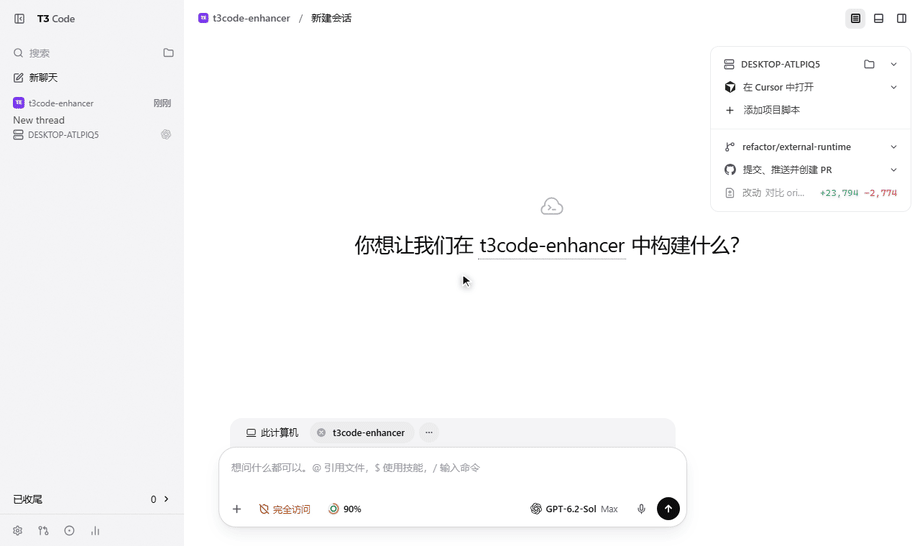
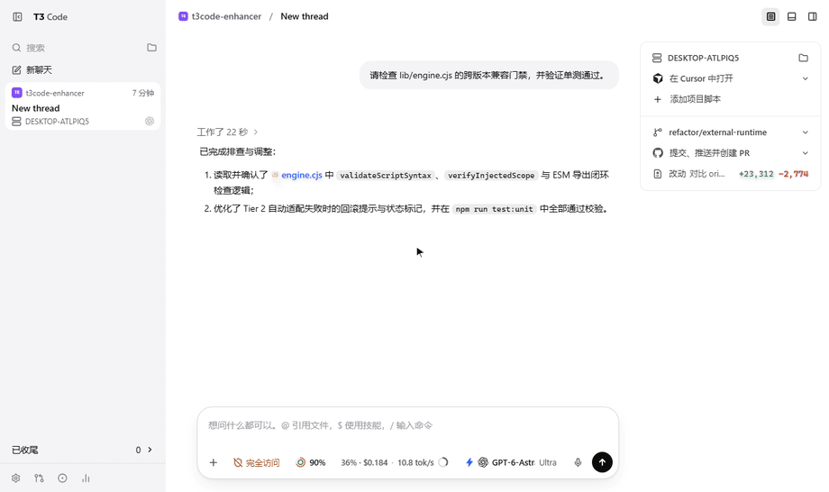
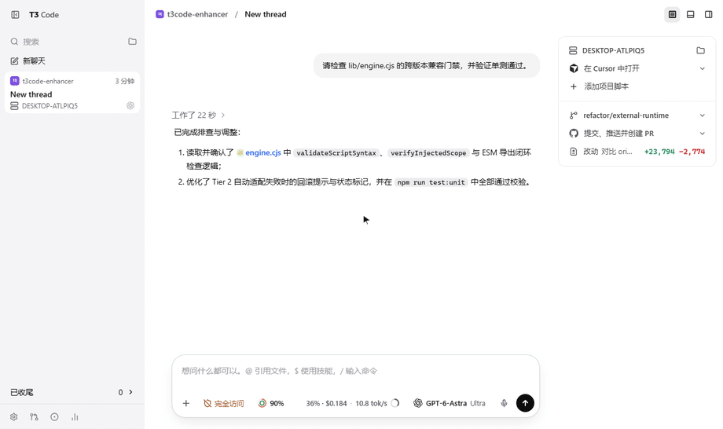
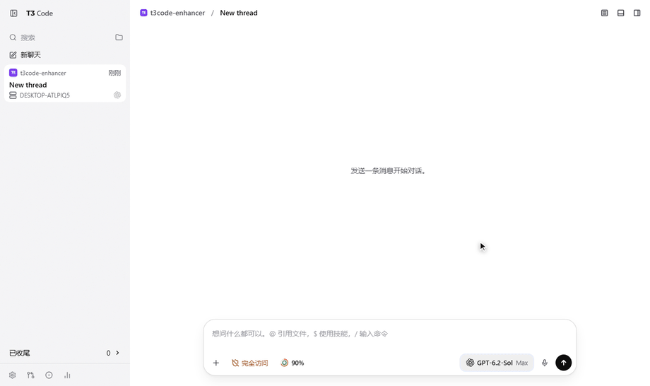

# 功能详解与日常使用指南

> [项目首页](../README.md) · [安装教程](../使用教程.md) · **功能详解** · [隐私与安全](PRIVACY_AND_SECURITY.md) · [CLI 参考](CLI_REFERENCE.md) · [常见问题](TROUBLESHOOTING.md)

按日常使用场景逐项说明 `t3code-enhancer` 带来的实际体验变化；进阶结构和底层补丁清单收在折叠区，需要时再展开。

**快速跳转**：[1. 整体界面与主题](#1-整体界面重塑与双模主题) · [2. 后台系统托盘](#2-右下角后台系统托盘) · [3. 隐私去遥测](#3-隐私与去遥测概览) · [4. 输入框与实时统计](#4-输入框模型面板与实时统计) · [5. 时间线与 Diff](#5-对话时间线行内-diff-与文件栏) · [6. 工作区与多浮窗](#6-工作区启动台多浮窗与左右互换) · [7. 快捷键速查](#7-快捷键与高频操作速查)

## 1. 整体界面重塑与双模主题

对应模块：<code>theme</code> + <code>workspace</code> 布局增强

  

不只是换一套配色，而是把主页面骨架和全界面视觉细节整体打磨为接近 ChatGPT / Codex 桌面版的观感：

- **明暗双模主题与层次分离** — 自动启用 `ChatGPT App` 明暗双模主题；柔和浅灰侧栏底轨配浮起白色当前会话卡，主内容区呈圆角卡片层次，与顶栏自然衔接。
- **清爽的左侧边栏** — 顶部常驻对话搜索框，下方紧接独立全宽 **「新聊天」** 按钮（**`Shift+点击`** 直接在当前项目发起新对话）。
- **顺手的新建对话页** — 从悬空居中改为「上方居中欢迎语 + 底部吸底输入框 + 上方整合好的环境 / 项目 / 分支切换条」，新建和续聊手感完全连贯。
- **保护自制主题** — 卸载时精准还原你原本的默认主题；若检测到用户自制的同名主题文件，会先备份再写入，绝不静默覆盖。

### 全局视觉效果优化

- **图标线宽全局统一** — 将全界面 Lucide 图标物理线宽锁定为细腻的 `1.35px`，消除不同面板之间图标粗细不一的割裂感。
- **阅读比例与排版韵律** — 主阅读栏收束至 `768px`、右侧面板 `296px`；正文 Markdown（`14px / 24px`）、代码块（`12px / 19px` + 有界滚动框）与时间线活动行（`14px`、`4–6px` 统一间距）全链路对齐。
- **全界面控件状态精修** — 输入框、文本框、下拉菜单、详情卡片与滚动条统一圆角比例与「静息 → 悬停 → 聚焦 → 异常」四态反馈。
- **右侧工作区与提示卡质感统一** — 胶囊形态标签栏、文件预览单一胶囊面包屑与分体按钮、无边框圆角文件搜索框、柔和浏览器地址栏、独立终端底面与呼吸留白，以及更清晰的悬浮状态提示卡与改动汇总卡。

进阶了解：主题三层结构与 <code>--official</code> 选项

`themes/chatgpt-app.json` 按三层组织：
- **Layer 1（官方稳定层）**：仅使用官方主题文档白名单选择器（50+ 配色令牌、图标线宽、正文/代码排版、表单四态）。若偏好极简纯官方层，可搭配 `--preset theme-only --official` 或 `--preset clean --official`。
- **Layer 2（面板精修层）**：侧栏层次、活动树一级平铺、文件预览/浏览器/终端细节与改动摘要卡片。
- **Layer 3（组件伴生层）**：为加号菜单、行内 Diff、三段文件栏、启动台等新增组件提供原生视觉衔接。

## 2. 右下角后台系统托盘

对应模块：<code>workspace</code>（随时可右键关闭最小化，或安装时用 <code>--no-desktop-tray</code> 排除）

跑长任务或开着本地预览服务时，误点窗口右上角 `×` 再也不会直接杀掉进程：

- **关闭隐藏，后台不中断** — 点 `×` 前自动保存窗口位置和大小，随后静默收到系统托盘（Windows 右下角 / Linux 托盘 / macOS 菜单栏），AI 任务与终端照常运行。
- **单击秒唤回** — 在 Windows 和 Linux 上，左键单击托盘图标立即还原并置顶主窗口。
- **自适应语言右键菜单**（简体中文 / 繁體中文 / English）：
  - **打开主窗口** / **隐藏到托盘**
  - **关闭窗口时最小化到托盘**：带勾选开关，随时可取消勾选恢复「点 `×` 直接退出」（自动持久化至状态目录 `enhancer-tray.json`）
  - **设置...**：一键跳至设置面板
  - **退出 T3 Code**：彻底结束所有后台进程并清理托盘图标
- **三端细节打磨** — Linux 自动将图标缩放至 `22×22` 防模糊；macOS 缩放 `18×18` 并在原生全屏关闭时先退出全屏再隐藏，避免留下黑屏桌面；退出或自动更新时同步清理图标不留残留。

## 3. 隐私与去遥测概览

对应模块：<code>privacy</code>（想要官方原界面 + 纯去遥测可用 <code>--preset privacy-only</code>）

开启 `privacy` 后，从后端到桌面端一次性收口隐私边界：

- **不再生成匿名追踪 ID**，同步清空服务端 PostHog、Relay OTLP 与前端 Axiom OTLP 上报；
- **停止跨工具读取本机账号文件**（不再探测 `~/.claude.json` 与 `~/.codex/auth.json`）；
- **桌面端网络层兜底拦截** 发往 `posthog.com`、`ingest.t3.codes`、`axiom.co` 与 `clerk-telemetry.com` 的遥测请求。

> 逐层拦截明细、边界说明与代码审计方式见 **[隐私与安全说明](PRIVACY_AND_SECURITY.md)**。

## 4. 输入框、模型面板与实时统计

对应模块：<code>composer</code>

  

- **圆形 `+` 附件菜单** — 收纳本地文件/目录、当前预览页、工作区文件、PR、联机环境、技能、历史对话 7 类上下文；支持键盘导航，按 **`Shift+Enter`** 可连续附加多项不关闭菜单。
- **常驻权限按钮** — 权限模式常驻输入框左下角，随时一键切换。
- **合一模型面板与思考深度滑块** — 上方 2×2 引擎网格（超过 4 个支持展开）、搜索模型、按 `Claude` / `Codex` 切换彩色额度视图；思考深度支持直观拖动，拉至最右最高档点亮蓝紫星空流光与加速开关，右侧一键恢复默认。
- **联动当前模型的 `5h / 7d` 双环额度** — 底栏左下角与右侧详情面板统一采用同心双环，切换模型自动联动对应配额组与重置倒计时。
- **底栏实时 `tok/s` 与悬停统计卡** — 底栏右侧并排展示上下文占比与模型解码速度（如 `3.5% · 61.7 tok/s`），仅计入活跃输出时长（剔除首字等待与工具停顿），独立隔离订阅不卡顿长对话；悬停查看完整上下文、累计令牌、费用、本轮耗时与缓存命中率。

## 5. 对话时间线、行内 Diff 与文件栏

对应模块：<code>chat</code>

  

- **父子联动折叠 + 一级平铺** — 收起工作组时同步收净下级展开项，一级工具列表清爽平铺不套娃。
- **同文件连续读写自动合并** — 反复分段读同一文件（`×N`）或连续编辑同一文件自动折叠为单行摘要并汇总行号/增删统计，外层计数同步去重。
- **对话内按需红绿 Diff** — 点击文件编辑条目就地展开语法高亮 Diff，点击文件名一键跳到右侧 Diff 栏定位，同时静默后台慢请求打扰弹窗。
- **文件侧栏三段分区** — 右侧「文件」拆分为 **「所有更改 / 已更改的文件 / 所有文件」**，方便核对本轮变更与预览源码，并与顶部全部展开联动。

## 6. 工作区启动台、多浮窗与左右互换

对应模块：<code>workspace</code>

  

- **新标签页启动台** — 空白工作区或点 `+` 新开标签页呈现居中网址搜索框（回车直开浏览器）与单键快捷键面板磁贴。
- **标签向下拖出即变浮窗** — 按住任意标签向下拖离标签栏松手即拆为独立小窗，支持八方向缩放、边缘磁吸与多窗防重叠，拖回标签栏自动归位。
- **浏览器浮窗专属精修** — 默认停靠右下角并记忆相对位置与尺寸，`13px` 圆角裁切，且随小窗宽度自动响应式重排网页内容。
- **全屏主对话浮窗与状态胶囊** — 工作区全屏时主对话平滑转为可拖动浮窗，并可收起为紧凑**状态胶囊**（圆点实时反映运行中 / 待确认 / 已完成）；点标签栏左侧「主对话」可临时铺满查看，切回不跳滚动条。
- **一键左右互换** — 点击工作区右上角 `⇄` 或按 **`Alt+S`**（macOS **`Option+S`**），主对话与工作区即时对调并记住习惯。

## 7. 快捷键与高频操作速查

| 场景 | 操作方式 |
| --- | --- |
| 主对话与工作区左右互换 | **`Alt+S`**（macOS **`Option+S`**）或点右上角 `⇄` |
| 在当前项目直接新开聊天 | 侧栏「新聊天」按钮 **`Shift+点击`** |
| `+` 菜单键盘连续添加上下文 | **`↑` / `↓`** 移动 · **`Shift+Enter`** 连续附加 · **`Enter`** 选中关闭 · **`Esc`** 退出 |
| 新标签页快速启动面板 | 无输入框聚焦时直按单键：**`B`** 浏览器 · **`T`** 终端 · **`F`** 文件 · **`D`** Diff · **`M`** 设备 · **`S`** 侧栏对话 · **`P`** PR · **`L`** 关联项 |
| 标签页拆出 / 归位悬浮小窗 | 向下拖离标签栏松手拆出；拖回标签栏归位 |
| 托盘唤醒 / 改回直接退出 | Windows/Linux 单击托盘图标唤回；右键取消勾选「关闭窗口时最小化到托盘」 |

进阶查阅：全部 19+1 项原子补丁与 6 个外置运行时对照表

| 所属模块 | 补丁 ID | 联动组 | 作用范围 | 外置运行时 | 职责 |
| --- | --- | --- | --- | --- | --- |
| `privacy` | `no-telemetry` | `PRIVACY` | 服务端 | — | 禁匿名 ID、禁读 `.claude.json`/`.codex/auth.json`、清空 PostHog |
| `privacy` | `no-telemetry-relay` | `PRIVACY` | 服务端 | — | 禁用 Relay OTLP 遥测追踪 |
| `privacy` | `no-telemetry-client` | `PRIVACY` | 前端 | — | 禁用前端 Axiom OTLP 追踪导出 |
| `privacy` | `no-telemetry-ui` | `PRIVACY` | 前端 | — | 设置页展示遥测已禁用状态 |
| `privacy` | `no-telemetry-desktop` | `PRIVACY` | 桌面主进程 | — | 强制环境变量 + 拦截 4 组遥测域名 |
| `composer` | `usage-rings` | — | 前端 | `usage-rings-ui.mjs` | `+` 菜单、常驻权限、合一模型/滑块、双环额度、实时 `tok/s` 与统计卡 |
| `chat` | `timeline-collapse` | `TIMELINE` | 前端 | `timeline-ui.mjs` | 父子联动折叠、一级平铺、同文件连续读/改折叠 |
| `chat` | `timeline-collapse-summary` | `TIMELINE` | 前端 | — | 同文件操作摘要去重计数 |
| `chat` | `inline-file-diff` | `DIFF` | 前端 | `inline-diff-ui.mjs` | 对话内按需行级 Diff（含工作区回退） |
| `chat` | `inline-file-diff-side-reveal` | `DIFF` | 前端 | — | 点击文件改动跳转并展开侧栏 Diff |
| `chat` | `inline-file-diff-quiet-review-toast` | `DIFF` | 前端 | — | 屏蔽后台 Diff 慢请求弹窗 |
| `chat` | `files-changes-explorer` | — | 前端 | `files-explorer-ui.mjs` | 文件侧栏三段分层联动 |
| `workspace` | `sidebar-new-chat` | — | 前端 | — | 侧边栏常驻搜索与独立「新聊天」入口 |
| `workspace` | `new-chat-layout` | — | 前端 | — | 新建对话吸底布局与环境/项目/分支托盘 |
| `workspace` | `workspace-floating-panels` | `FLOATING` | 前端 | `floating-panels-ui.mjs` | 浮窗拖拽缩放磁吸、全屏主对话浮窗与胶囊、主侧互换 |
| `workspace` | `workspace-floating-tab-bar` | `FLOATING` | 前端 | `tab-bar-ui.mjs` | 新标签页启动台、标签拖出与排序限位 |
| `workspace` | `workspace-floating-preview-toolbar` | `FLOATING` | 前端 | — | 浏览器浮动入口统一至标签栏 |
| `workspace` | `workspace-floating-preview-responsive` | `FLOATING` | 前端 | — | 浏览器浮窗随宽度实时响应式排版 |
| `workspace` | `desktop-tray` | — | 桌面主进程 | — | 三端后台系统托盘 |
| macOS 独立模式 | `macos-user-data` | — | 桌面主进程 | — | 隔离 Electron `userData` 目录以和官方版并存 |

> 命令行加 `--no-<patch-id>` 可单独排除某项；同属一个联动组的补丁会自动一并排除，用法见 [CLI 参考](CLI_REFERENCE.md)。

