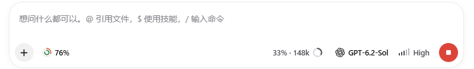
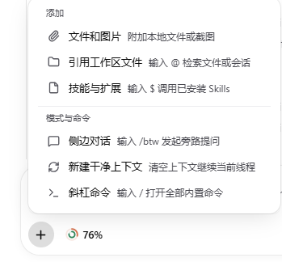
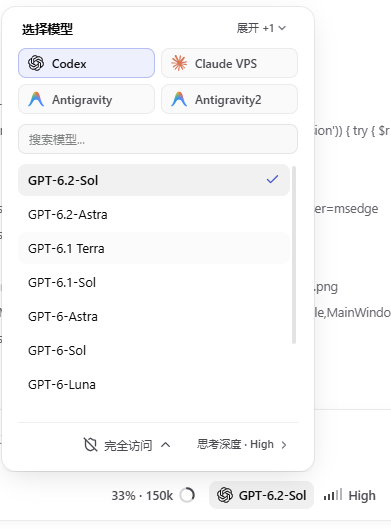
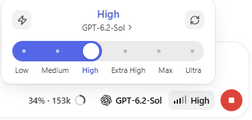
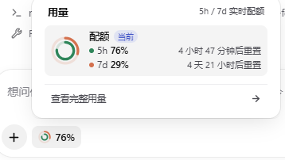
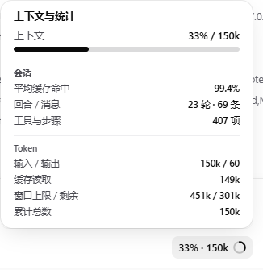
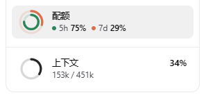
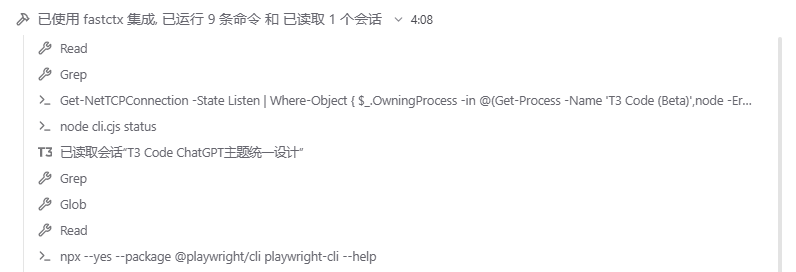

# t3code-enhancer 使用教程

把 T3 Code 的外观和几处常用操作调整为 ChatGPT / Codex 桌面版风格。

> 适用版本为 T3 Code 0.1.11。支持 Windows 桌面版、Linux x86_64 官方 AppImage 和 macOS 官方版。

## 一、装好后有什么变化

| 位置 | 原版 T3 Code | 装好后 |
|---|---|---|
| 整体外观 | T3 默认配色 | ChatGPT 风格明暗双主题：阅读栏 768px、右侧面板 296px，全界面图标线宽和尺寸统一 |
| 对话过程折叠 | 收起上级后，下级仍保持展开 | 收起某个回合或工具组时，它里面的下级一起收起 |
| 输入框左下角 | 回形针附件按钮 | 圆形 + 号菜单：文件和图片、@ 引用工作区文件、$ 技能与扩展、/btw 侧边对话、压缩上下文、新建干净上下文、/ 全部斜杠命令 |
| 模型按钮 | 原生三栏模型面板 | 「选择模型」卡片：上方是已开启的 Harness（超过 4 个可展开），中间是模型列表，底部是访问权限和「思考深度」入口 |
| 思考深度 | 藏在模型面板里 | 单独一个按钮，点开是滑块，拖动或点击选择强度，带快速模式开关和恢复默认 |
| 左下角额度 | 无 | 圆环显示**当前所选模型**的剩余额度，鼠标移上去显示 5h / 7d 用量和重置时间 |
| 右下角上下文 | 只有小圆环 | 直接显示如「19% · 204k」，鼠标移上去显示上下文、费用、缓存命中、Token 明细 |
| 右侧详情面板 | 普通额度条 | 5h / 7d 额度合成一个同心双环（外环 7d，内环 5h，额度低时变橙、变红） |

### 输入框与加号菜单

输入框左下角是加号菜单和当前模型的额度环。右下角是上下文、模型、思考深度、权限和发送按钮。输入框变窄时，模型名称会按可用宽度截断，上下文按钮和部分文字会收起，其余按钮仍可操作。



点击 **+** 可以添加文件、引用工作区文件、调用技能，或打开侧边对话与斜杠命令菜单。



### 选择模型与思考深度

点击底栏的模型名，在卡片顶部切换 Harness，然后从列表中选择模型。可以在卡片底部切换访问权限，或进入思考深度面板。



点击底栏上的档位图标也能直接打开**思考深度**面板。点击或拖动滑块可以选档，右上角的按钮可恢复默认值。可用档位随模型变化。



### 查看额度与上下文

把鼠标移到左侧额度环上，可以查看当前模型的 5 小时和 7 天剩余额度、重置时间，并打开完整用量页面。



把鼠标移到右侧上下文环上，可以查看当前占用、缓存命中率、会话统计和 Token 明细。



打开右侧详情面板，也可以同时查看额度双环和上下文占用。



### 展开与收起工作过程

点击带箭头的工作组标题可以查看命令和工具条目。收起上级后再展开，下级条目从折叠状态开始。



## 二、准备

1. **安装 Node.js 20 或更高版本。** 在终端运行 `node --version` 查看版本。
2. **解压增强包。** Windows 的入口是 `install.cmd`，Linux 的入口是 `linux.cjs`，macOS 的入口是 `macos.cjs`。

## 三、安装

### Windows

1. **彻底退出 T3 Code**（所有窗口都关掉；如果托盘里还有图标，也右键退出）。
2. 双击 **install.cmd**。
3. 窗口里提示完成后，按任意键关闭窗口。
4. 重新打开 T3 Code。安装程序会自动把主题切换成 chatgpt-app。

**只想换配色、不改界面？** 在解压出来的文件夹里，点地址栏输入 cmd 回车，然后执行：

~~~
node cli.cjs install --theme-only
~~~

这个命令不用退出 T3 Code。

### Linux x86_64 AppImage

从 [T3 Code 0.1.11 官方发布页](https://github.com/pingdotgg/t3code/releases/tag/v0.1.11) 下载 `T3-Code-x86_64.AppImage`。进入增强包解压目录，以普通用户运行：

```bash
node linux.cjs install ~/Downloads/T3-Code-x86_64.AppImage
"${XDG_DATA_HOME:-$HOME/.local/share}/t3code-enhancer/launch.sh"
```

如果 AppImage 在其他目录，把第一行的路径换成实际路径。启动后可在「设置 → 外观」选择 **ChatGPT App**。增强版使用独立的配置和会话目录，默认监听本地端口 `3774`。端口已占用时，可以这样启动：

```bash
T3CODE_PORT=3775 "${XDG_DATA_HOME:-$HOME/.local/share}/t3code-enhancer/launch.sh"
```

在增强包解压目录运行 `node linux.cjs status` 检查状态。退出增强版后运行 `node linux.cjs uninstall` 卸载。增强版的会话和偏好保存在 `t3code-enhancer-profile`，重新安装可继续使用。

从旧版升级时，退出增强版，先运行 `node linux.cjs uninstall`，再用新版增强包和同一个官方 AppImage 重新安装。安装和卸载时使用相同的 `XDG_DATA_HOME`，即可沿用原来的会话和偏好。

### macOS

先安装 [T3 Code 0.1.11 官方版](https://github.com/pingdotgg/t3code/releases/tag/v0.1.11)。进入增强包解压目录，在终端运行：

```bash
node macos.cjs install
open "$HOME/Applications/T3 Code Enhancer.app"
```

官方版默认在 `/Applications/T3 Code (Beta).app`，放在其他位置时，把路径加在 `install` 后面。也可以在「访达 → 应用程序（个人）」里双击 **T3 Code Enhancer** 启动。启动后可在「设置 → 外观」选择 **ChatGPT App**。增强版使用独立的配置和会话目录，监听本地端口 `3774`，不会自动更新。

在增强包解压目录运行 `node macos.cjs status` 检查状态。退出增强版后运行 `node macos.cjs uninstall` 卸载。增强版的会话和偏好保存在 `~/Library/Application Support/t3code-enhancer-profile`，重新安装可继续使用。

如果状态显示「已安装旧版」，退出增强版，在新版增强包目录重新运行 `node macos.cjs install`。如果官方 T3 Code 0.1.11 放在其他位置，仍需在命令后加上官方 App 的路径。升级会沿用原有的数据模式、会话和设置。

**想用原来的会话和项目？** 安装时加上 `--shared-data`：

```bash
node macos.cjs install --shared-data
```

这样增强版和官方版用同一份数据，打开就是原来的会话、项目和设置。两者不能同时运行，切换前先在菜单里退出另一个。增强版第一次读取钥匙串时会弹窗询问，选择「始终允许」。官方版自动更新到新版本后可能升级数据格式，而增强版仍是 0.1.11，这时先停用增强版。已经按独立配置安装过的，先运行 `node macos.cjs uninstall`，再加 `--shared-data` 重新安装。

## 四、查看安装状态

双击 **status.cmd**。它会列出：

- T3 Code 是否正在运行；
- 主题和每个补丁是否已安装、是不是最新版本；
- 原版备份是否完好。

如果某个补丁显示「已安装旧版」，退出 T3 Code 后再双击一次 install.cmd 就能升级。

## 五、卸载还原

1. 彻底退出 T3 Code。
2. 双击 **uninstall.cmd**。
3. 重新打开 T3 Code。界面会恢复成原版，主题也切回默认。

只想去掉界面补丁、保留配色：

~~~
node cli.cjs uninstall --keep-theme
~~~

## 六、它动了哪些东西

Windows 安装器会写入以下文件。

- **T3 Code 安装目录里的 server.asar**（前端界面文件）。第一次安装前，会先把原版备份成同目录下的 server.asar.before-t3code-enhancer，卸载时用这个备份逐字节还原。
- **T3 的主题文件夹**里会多一个 chatgpt-app 主题，T3 设置里的主题会切到它。

每次写入前，安装程序都会先检查语法、重算完整性校验，确认没改到的文件和原版一模一样，有问题就中止，不会写入。

Linux 安装器在用户数据目录解包并修改一个独立副本。它会校验下载的 AppImage 和两个目标前端文件，并逐字节检查 ASAR 中未修改的内容。平时可以直接启动官方 AppImage，使用原来的配置和会话。

macOS 安装器先校验官方 T3 Code 的签名和版本，再复制出 `~/Applications/T3 Code Enhancer.app` 并修改这个副本：打上同样两个前端补丁，把 Electron 用户数据目录移到独立配置目录，更新 Info.plist（ASAR 校验值、应用标识、独立配置和端口的环境变量），最后用本机 ad-hoc 签名。官方版的文件和签名保持不变，可以和增强版同时运行。两个版本启动时都会登记 `t3code://` 登录回调，最后启动的那个生效；要在官方版里登录 T3 账号，先重启官方版。

## 七、常见问题

**提示「请先关闭所有 T3 Code 窗口」**
后台还有 T3 Code 进程。打开任务管理器，结束所有 T3 Code 进程后再试。

**提示「找不到未修改的原版 T3 Code 0.1.11 server.asar」**
你的 T3 Code 不是 0.1.11，界面补丁暂时不适配。这时仍可以只装主题（见第三节的 --theme-only）。

**T3 Code 自动更新后，界面补丁没了**
更新会覆盖 server.asar。先双击 status.cmd 看状态：版本没变就重新运行 install.cmd；版本变了，就只装主题，等补丁适配新版本。

**弹出的窗口里中文是乱码**
脚本已经切换到 UTF-8。如果还是乱码，在 Windows Terminal 里进入该文件夹，运行 node cli.cjs status。

**想确认补丁本身没问题**
运行 node tests/verify.cjs。它只在副本上试构建、做校验，不会改动已安装的 T3 Code。看到 ALL TESTS PASSED 就是正常的。

## 更新记录

- **v0.1.1** 新增 macOS 安装与升级，给思考深度最高档加入动效，并修复窄输入栏底部按钮重叠。
- **v0.1.0** 支持 T3 Code 0.1.11 的 Windows 桌面版和 Linux x86_64 AppImage。

### 开发期变更记录

- **v1.5.0** 新增 Linux x86_64 AppImage 安装器与独立启动入口。
- **v1.4.3** 首次在 GitHub 开源发布，附带许可证和安装 ZIP。
- **v1.4.2** 增补八张新版实机截图，解压后可直接在教程中查看。
- **v1.4.1**：修复窄窗口下底栏互相覆盖：输入框变窄时，先收起右下角上下文的文字，再收起额度百分比和思考深度文字，模型名按剩余宽度截断。
- **v1.4.0**：新面板里的图标统一成同一套线性图标。勾选、右箭头、展开/收起箭头、「查看完整用量」箭头不再用文字符号，尺寸固定；模型列表去掉每行重复的提供方图标；新增这份教程。
- **v1.3.0**：模型按钮和思考深度按钮完全替换原生面板，两张卡片设计统一；额度环跟随当前所选模型。
